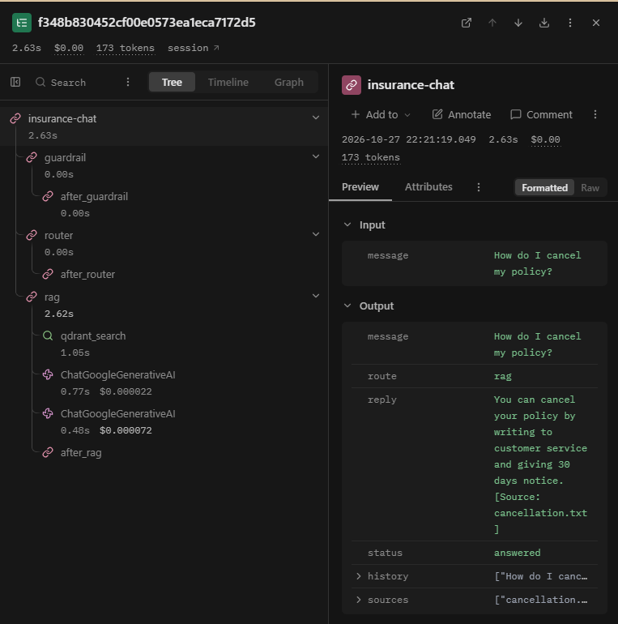

# Insurance Assistant Agent


A small, end-to-end AI customer-support agent for a **fictional** insurance company. It answers policy questions from retrieved documents (with citations), looks up policies and claims by ID, blocks unsafe requests, and hands over to a human when it cannot answer reliably. Every run is traced in Langfuse and checked by automated tests in GitHub Actions.

> Portfolio prototype. All policies, customers and claims are fictional. It makes no real insurance decisions.

```text
POST /chat  {"session_id": "demo-1", "message": "How do I cancel my policy?"}

→ {"reply": "You can cancel your policy by writing to customer service and giving 30 days notice. [Source: cancellation.txt]",
   "status": "answered", "sources": ["cancellation.txt"]}
```

## What it does

| Customer sends | Agent does | Status |
|---|---|---|
| `How do I cancel my policy?` | Searches policy documents, writes a short answer, cites the source | `answered` |
| `What is the status of CLM-002?` | Calls the `claim_status()` tool | `answered` |
| `POL-001` | Calls the `get_policy()` tool | `answered` |
| `POL-999`, `What is the weather today?` | Cannot answer reliably, so hands over to a colleague | `handover` |
| `What is my password?` | Guardrail blocks the request | `blocked` |

## Architecture

```text
POST /chat
   |
   v
guardrail --blocked--> fallback (safe reply)
   |
   v
router --"CLM-"--> claim  --> respond
   |   --"POL-"--> policy --> respond
   |   --other--> rag
   |               |-- search (Qdrant, Gemini embeddings)
   |               |-- score < 0.60 or not relevant --> handover
   |               |-- Gemini writes 1-2 sentence answer from the text only
   |               |-- "NOT IN TEXT" --> handover
   |               '-- reply + [Source: file]  (citation added by code, not the LLM)
   v
unknown ID / no evidence --> handover (fixed text, no LLM)

Session memory: LangGraph checkpointer, thread_id = session_id
Tracing:        Langfuse CallbackHandler on every graph run
```

Design choices:
- **Handover is a final outcome**, not a prompt to keep generating. If evidence is missing, the agent says so instead of guessing.
- **The citation is added by code**, so the LLM cannot invent or misspell a source file name.
- **Two-step relevance gate** (score threshold 0.60 + a Gemini YES/NO relevance check). The threshold was chosen by manual calibration on 10 questions (5 answerable, 5 not). A threshold alone was not enough: answerable questions scored 0.674–0.769 and unanswerable ones 0.565–0.69, so the ranges overlap. A threshold of 0.70 rejected 2 of 5 answerable questions, and 0.67 let unanswerable ones through. So 0.60 only filters obvious junk, and the YES/NO check decides the rest. With both steps, all 10 calibration questions were handled correctly (one run, small set).

## Tech stack

| Technology | Role |
|---|---|
| Python 3.14 | Language. Tested on 3.14.3 (Windows, local), 3.14 on Ubuntu (GitHub Actions, clean install) and `python:3.14-slim` (Docker) |
| FastAPI + Pydantic | REST API and request/response validation |
| LangGraph | Agent workflow, conditional routing, session memory |
| LangChain + `langchain-google-genai` | Gemini chat model and embeddings |
| Google Gemini (`gemini-3.5-flash-lite`, `gemini-embedding-001`) | Relevance check, answer writing, embeddings (free tier) |
| Qdrant (in-memory) | Vector search over policy documents |
| Langfuse (Cloud EU) | Tracing: steps, latency, tokens, cost estimate |
| pytest | Unit, graph, API and evaluation tests |
| Docker | Reproducible runtime |
| GitHub Actions | CI on every push |

## Langfuse trace



One `/chat` request shows each step: guardrail → router → rag → `qdrant_search` (retriever) → two Gemini calls (relevance check, answer) with latency and a cost estimate. In this trace the search was the slowest step (about 1 s).

## Run it

You need a free Gemini API key ([Google AI Studio](https://aistudio.google.com/)) and, optionally, Langfuse keys ([cloud.langfuse.com](https://cloud.langfuse.com)).

```bash
cp .env.example .env      # then fill in your keys, WITHOUT quotes
```

### With Docker

```bash
docker build -t insurance-agent .
docker run --rm -p 8000:8000 --env-file .env insurance-agent
```

Keys are passed at runtime with `--env-file` (see [Security](#security)).

### Without Docker

```bash
python -m venv .venv
source .venv/bin/activate          # Windows: .venv\Scripts\Activate.ps1
pip install -r requirements.txt
uvicorn app.main:app --reload
```

## Example requests

```bash
curl http://127.0.0.1:8000/health
```
```json
{"status": "ok", "langfuse": "ok"}
```
`/health` always returns **HTTP 200** when the app is running, because the agent works without Langfuse. The `langfuse` field reports the tracing setup honestly: `ok`, `missing keys`, `invalid keys` or `error: <ErrorName>`. Only the error name is shown, never internal details.

```bash
curl -X POST http://127.0.0.1:8000/chat \
  -H "Content-Type: application/json" \
  -d '{"session_id": "demo-1", "message": "How do I cancel my policy?"}'
```
```json
{
  "reply": "You can cancel your policy by writing to customer service and giving 30 days notice. [Source: cancellation.txt]",
  "status": "answered",
  "sources": ["cancellation.txt"]
}
```

```json
{"reply": "I can't answer that reliably. I'll connect you with a colleague.", "status": "handover", "sources": []}
```

## Tests and evaluation

Results below are from real runs, not estimates.

**Layer A: deterministic tests (CI).** No API keys, no network, no cost. Gemini and the search are replaced by fakes, and Langfuse tracing is switched off.

```bash
pytest -v
```
Result: **41 passed, 5 skipped** (locally and in GitHub Actions).

Includes **20 evaluation cases** in `evals/cases.json`, one test class per group. They deliberately include hard inputs, not just easy ones: known and unknown IDs, IDs inside a sentence, wrong letter case, malformed IDs that used to crash the agent, and mixed-case blocked words.

| Class | Cases | Checks |
|---|---|---|
| `TestPolicyLookup` | 5 | Policy IDs: known, unknown, inside a sentence, lowercase |
| `TestClaimLookup` | 5 | Claim IDs, including `CLM-abc` (this case found a crash bug, now fixed) |
| `TestRag` | 5 | If file X is found, the reply cites X |
| `TestGuardrail` | 5 | Blocked words (case-insensitive) and out-of-scope → handover |

**Real retrieval (opt-in, needs `GOOGLE_API_KEY`).** The same 5 RAG questions from `TestRag` (one per policy document), now with real Gemini embeddings and Qdrant instead of fakes. Skipped by default and in CI:

```bash
RUN_REAL_EVALS=1 pytest tests/test_evals.py -v      # PowerShell: $env:RUN_REAL_EVALS="1"
```
Result: on 5 representative questions, all retrieved the expected document.

**Layer B: LLM-as-judge (optional, separate from CI).** Gemini grades each real answer for *grounded* (every fact is in the policy text) and *relevant* (it answers the question), from 0 to 1. Pass = both ≥ 0.7.

```bash
python -m evals.run_judge
```
Result: on the same 5 questions, all answers scored ≥ 0.7 on both criteria (`evals/judge_results.json`). Sanity check: a deliberately invented answer ("90 days" when the text says 60) scored grounded 0.0, so the judge can fail answers.

These are **estimates, not proof**: the same model grades its own answers, the set is small (5 cases), and Gemini is not fully repeatable between runs.

## Security

- **No secrets in the repo:** `.env` is git-ignored. `.env.example` contains placeholders only. Git history was checked for real key patterns before the first push (0 matches).
- **No secrets in the Docker image:** `.dockerignore` excludes `.env`, `.venv/` and `.git/`. Keys are passed only at runtime (`docker run --env-file .env`). Verified by listing the image contents (no `.env`).
- **Use `.env` values without quotes.** Docker's `--env-file` keeps quotes literally (this broke the Langfuse URL during testing, and `/health` reported it).
- **Tests never call external services:** CI runs without keys, Gemini and search are faked, and Langfuse tracing is disabled in tests.
- **No internal error details are exposed:** `/health` shows only the error name.
- **Synthetic data only:** the Gemini free tier may use inputs to improve Google's products.

## Known limitations

- Policy documents, customers and claims are **fictional**.
- **No authentication or authorization.** Anyone can look up any claim ID.
- **Memory and vector store are in-memory**. Both are lost on restart.
- **The keyword guardrail is not real AI security.** It only blocks a short word list.
- **The router is rule-based** (`CLM-` / `POL-` prefixes). IDs are case-sensitive, so `pol-001` is not treated as a policy ID.
- **Handover returns a message only.** It does not contact a real employee or create a ticket.
- **Tool answers are printed as raw data** (e.g. `{'policy_id': 'POL-002', 'status': 'approved'}`).
- **Embedding calls are not traced** in Langfuse (LangChain embeddings have no callbacks).
- **Cost in Langfuse is a paid-tier estimate.** Actual spend on the Gemini free tier is $0. Free-tier inputs may be used by Google to improve its products, so use only synthetic data.
- **The LLM-as-judge is self-grading** and based on a small set.

## Future work

Authenticated access and customer-level authorization, persistent storage for sessions and vectors, LLM-based routing, stronger guardrails and security testing, natural-language tool answers, a real human-support integration, a larger evaluation set with an independent judge model.
